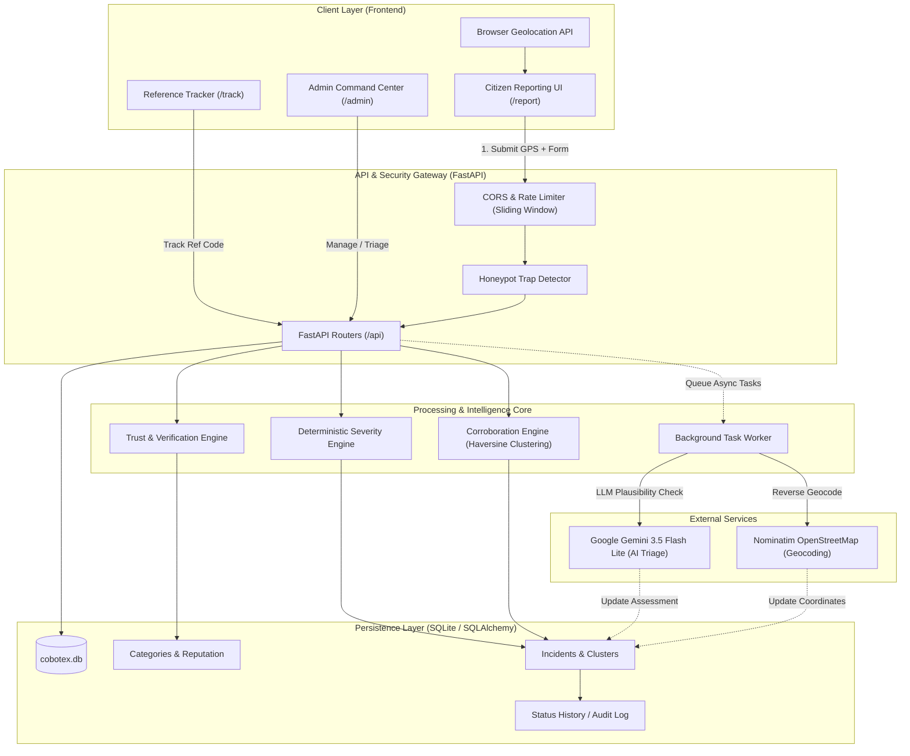
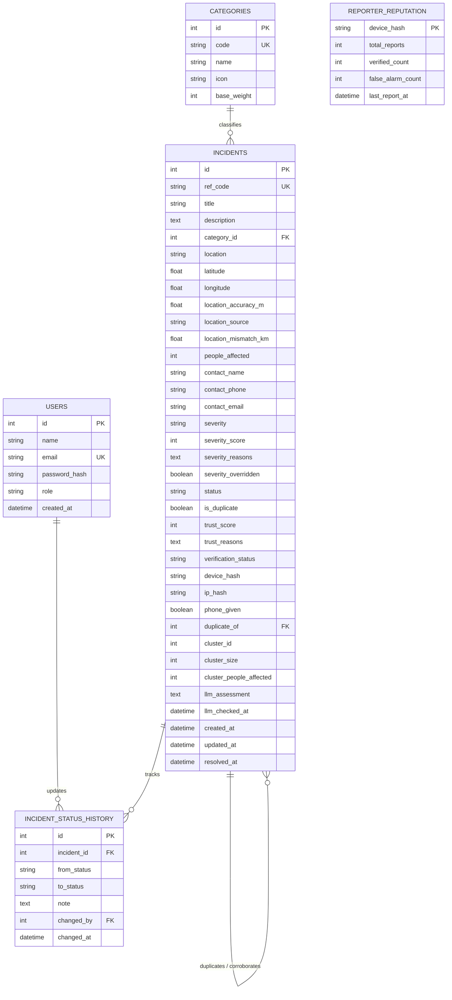

# 🚨 ResQNet — Emergency Incident Reporting & Monitoring Platform

An intelligent, real-time emergency triage and disaster management system built with **FastAPI**, **React 18**, and **Google Gemini AI**. Designed to accelerate first responder dispatch, eliminate duplicate report chaos, and filter fraudulent alerts through automated trust scoring.

---

## 📌 1. The Problem

In high-stress disaster and emergency situations, emergency response centers (911/112 dispatchers) encounter severe operational bottlenecks:

1. **Delayed Triage & Prioritization:** Critical life-threatening emergencies (e.g., building collapses, flash floods) are treated in FIFO order alongside minor complaints due to lack of immediate severity categorization.
2. **Spam & Bot Inundation:** Open public reporting forms are vulnerable to bot flooding, prank calls, and fabricated incidents that divert precious rescue resources.
3. **Duplicate Report Chaos:** When a major disaster occurs in a public area, dozens of citizens submit reports for the exact same event, overwhelming dispatchers with duplicate tickets.
4. **Location Inaccuracies & Fabrication:** Callers often provide ambiguous landmarks or intentionally spoof locations, causing dispatchers to send teams to the wrong locations.
5. **Citizen Anxiety & Zero Visibility:** Reporters receive no feedback after calling or submitting a report, leading to repeated panic calls to check status.

---

## 💡 2. The Solution

ResQNet addresses these challenges through a multi-tier, automated verification and response pipeline:

* **Dual-Layer Severity Triage:**
  * **Deterministic Rules Engine:** Instantly assigns severity (`Low`, `Medium`, `High`, `Critical`) and score (0–100) using category weights, affected casualty thresholds, and keyword heuristics.
  * **Google Gemini 3.5 Flash Lite Live Triage:** Performs semantic evaluation of the incident description, validates plausibility, extracts hazard flags, and suggests actionable first-responder priorities.
* **Multi-Factor Trust & Verification Scoring:**
  * Computes a dynamic Trust Score (0–100) combining **Device Reputation**, **Reporter Contact Verifiability**, **Location Accuracy**, and **Honeypot Bot Trap Detection**.
  * Classifies reports into actionable trust tiers: `Verified`, `High Confidence`, `Unverified`, or `Suspicious`.
* **Spatial-Temporal Corroboration & Clustering Engine:**
  * Groups nearby reports within a geographic threshold (Haversine distance) and time window.
  * Links secondary reports to primary incidents, automatically increments cluster counts, and aggregates estimated casualty totals without cluttering the dispatch queue.
* **GPS & Geocoding Cross-Verification:**
  * Compares browser GPS coordinates against Nominatim reverse-geocoded physical addresses.
  * Flags location discrepancies greater than threshold distances to highlight potential hoaxes.
* **Public Tracking & Command Dashboard:**
  * Citizen reference codes (`ER-YYYY-XXXX`) allow public tracking of emergency status in real time.
  * Interactive administrative dashboard with real-time statistics, critical incident alert banners, status progression workflows, and audit timelines.

---

## 🏛️ 3. System Architecture



---

## 🗄️ 4. Database Schema

The database is built on **SQLAlchemy ORM** targeting **SQLite** (or PostgreSQL in production).

### Tables Overview

| Table | Description |
|---|---|
| `categories` | Emergency types with baseline severity weights and iconography |
| `users` | Responders, dispatchers, and system administrators |
| `reporter_reputation` | Device and IP reputation tracking past verified vs. false alarm reports |
| `incidents` | Core incident data, severity metrics, trust scores, clustering, and AI assessments |
| `incident_status_history` | Immutable audit trail of status transitions, notes, and dispatcher actions |

---

### Detailed Column Specifications

#### 1. `categories`
* `id` (INTEGER, PK): Unique category ID.
* `code` (VARCHAR(20), UNIQUE, INDEX): Machine-readable identifier (`FIRE`, `FLOOD`, `COLLAPSE`, `MEDICAL`, `ROAD`, `OTHER`).
* `name` (VARCHAR(50)): Display name.
* `icon` (VARCHAR(8)): Visual emoji or icon key.
* `base_weight` (INTEGER): Baseline severity weight for the rule engine.

#### 2. `users`
* `id` (INTEGER, PK): Unique user ID.
* `name` (VARCHAR(80)): Responder/Admin full name.
* `email` (VARCHAR(120), UNIQUE, INDEX): Login email.
* `password_hash` (VARCHAR(200)): Bcrypt password hash.
* `role` (VARCHAR(20)): User role (`admin`, `responder`, `user`).
* `created_at` (DATETIME): Registration timestamp (UTC).

#### 3. `reporter_reputation`
* `device_hash` (VARCHAR(64), PK): SHA-256 hash of device fingerprint.
* `total_reports` (INTEGER): Cumulative reports submitted.
* `verified_count` (INTEGER): Reports confirmed valid by responders.
* `false_alarm_count` (INTEGER): Reports flagged as false alarms/hoaxes.
* `last_report_at` (DATETIME): Timestamp of most recent report.

#### 4. `incidents`
* `id` (INTEGER, PK): Primary key ID.
* `ref_code` (VARCHAR(20), UNIQUE, INDEX): Human-readable reference code (`ER-2026-0001`).
* `title` (VARCHAR(120)): Short emergency summary.
* `description` (TEXT): Full incident description.
* `category_id` (INTEGER, FK -> `categories.id`): Associated category.
* `location` (VARCHAR(200)): Descriptive landmark or address.
* `latitude` / `longitude` (FLOAT, NULLABLE): GPS coordinates.
* `location_accuracy_m` (FLOAT, NULLABLE): GPS accuracy in meters.
* `location_source` (VARCHAR(20)): Source type (`gps`, `manual`, `ip`).
* `location_mismatch_km` (FLOAT, NULLABLE): Distance between GPS and geocoded text.
* `people_affected` (INTEGER): Estimated number of casualties / trapped individuals.
* `contact_name` / `contact_phone` / `contact_email` (VARCHAR, NULLABLE): Reporter contact details.
* `severity` (VARCHAR(20), INDEX): `Low`, `Medium`, `High`, or `Critical`.
* `severity_score` (INTEGER): Calculated score from 0 to 100.
* `severity_reasons` (TEXT): JSON array of scoring criteria applied.
* `severity_overridden` (BOOLEAN): Flag if dispatcher manually changed severity.
* `status` (VARCHAR(20), INDEX): `Reported`, `Pending`, `In Progress`, `Resolved`, `False Alarm`.
* `is_duplicate` (BOOLEAN): Marked if corroborated with an existing event.
* `trust_score` (INTEGER): Confidence score (0–100).
* `trust_reasons` (TEXT): JSON array of trust factors.
* `verification_status` (VARCHAR(20), INDEX): `Unverified`, `Corroborated`, `Verified`, `False Alarm`.
* `device_hash` / `ip_hash` (VARCHAR(64), INDEX): Privacy-preserving client hashes.
* `duplicate_of` (INTEGER, FK -> `incidents.id`, NULLABLE): Reference to primary incident.
* `cluster_id` (INTEGER, INDEX, NULLABLE): Group ID for spatial-temporal incident clusters.
* `cluster_size` (INTEGER): Total corroborated reports in this cluster.
* `cluster_people_affected` (INTEGER, NULLABLE): Aggregate casualties across the cluster.
* `llm_assessment` (TEXT, NULLABLE): Gemini AI summary, triage assessment, and hazard detection.
* `llm_checked_at` (DATETIME, NULLABLE): Timestamp of Gemini evaluation.
* `created_at` / `updated_at` (DATETIME): UTC audit timestamps.
* `resolved_at` (DATETIME, NULLABLE): Timestamp of incident resolution.

#### 5. `incident_status_history`
* `id` (INTEGER, PK): Audit entry ID.
* `incident_id` (INTEGER, FK -> `incidents.id` ON DELETE CASCADE): Linked incident.
* `from_status` (VARCHAR(20), NULLABLE): Previous state.
* `to_status` (VARCHAR(20)): New state.
* `note` (TEXT, NULLABLE): Dispatcher note explaining transition.
* `changed_by` (INTEGER, FK -> `users.id`, NULLABLE): Dispatcher who triggered change.
* `changed_at` (DATETIME): Timestamp of state transition.

---

## 📊 5. Entity-Relationship (ER) Diagram



---

## ⚡ 6. Quick Start & Execution Guide

### Prerequisites
- Python 3.10+
- Node.js 18+

### Setup & Run

#### 1. Backend Service
```powershell
# Navigate to backend directory
cd backend

# Install dependencies
pip install -r requirements.txt

# Seed sample data (Categories, Admin, 12 Incidents)
python -m app.seed

# Start FastAPI server
uvicorn app.main:app --reload --port 8000
```
* Interactive Swagger API Docs: `http://localhost:8000/docs`
* API Root: `http://localhost:8000/api`

#### 2. Frontend Application
```powershell
# Navigate to frontend directory
cd frontend

# Install dependencies (if not already installed)
npm install

# Start Vite dev server
npm run dev
```
* Application URL: `http://localhost:5173`

#### 3. Standalone Frontend Demo (No Backend Required)
To demonstrate the full user interface without running the backend service:
```powershell
cd frontend
npm run dev:mock
```

---

## 🔐 7. Default Credentials

| Portal | URL | Email | Password | Role |
|---|---|---|---|---|
| **Admin Command Center** | `http://localhost:5173/admin/login` | `admin@codeclash.dev` | `admin123` | Administrator / Dispatcher |
| **Public Emergency Form** | `http://localhost:5173/report` | *(No login required)* | *(Anonymous reporting supported)* | Citizen |

